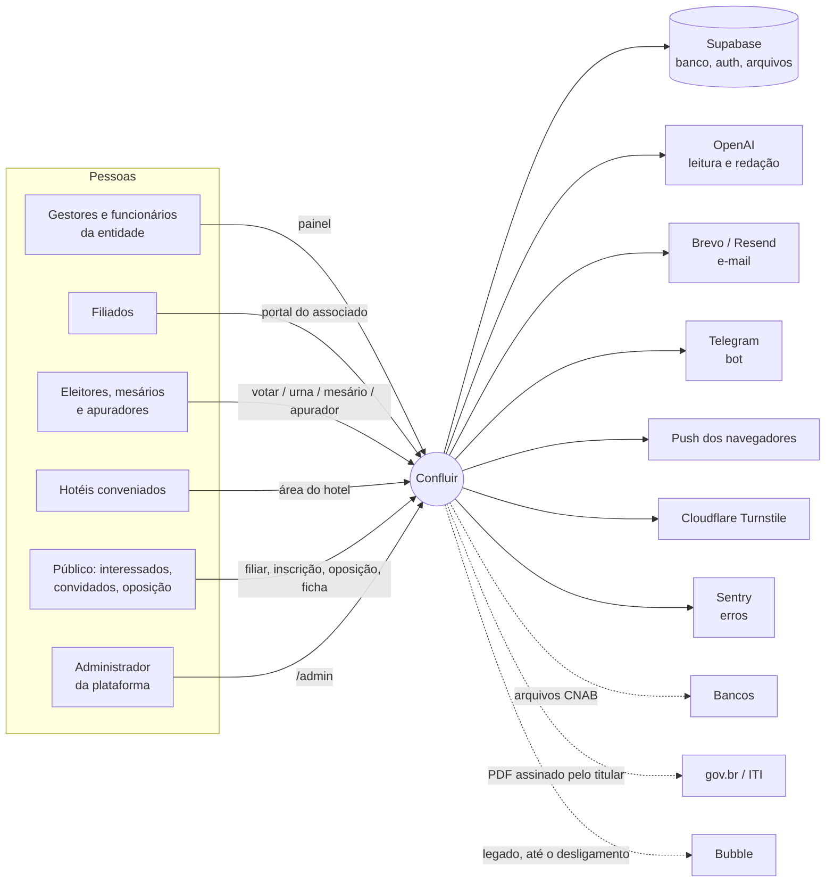
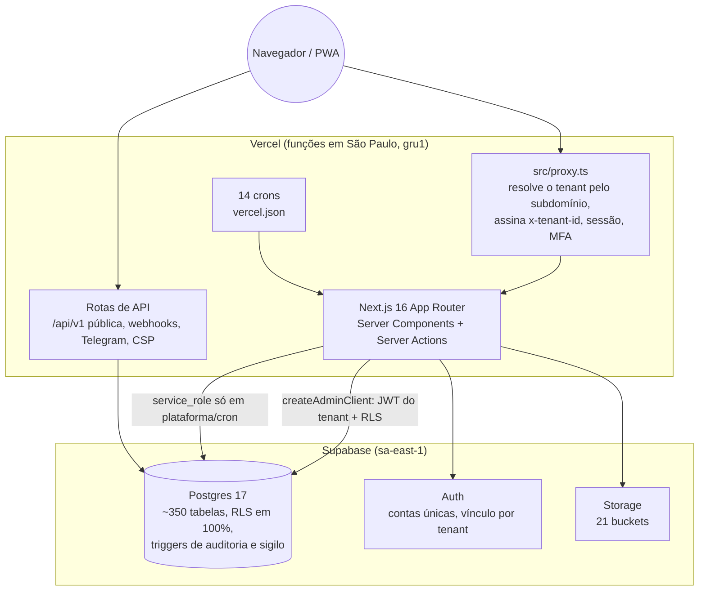

# Arquitetura do Confluir

> **Onda D** (`docs/plano-documentacao.md`), 18/10/2026. Visão da arquitetura em três níveis (modelo C4: contexto, containers, componentes) e o índice das decisões registradas em [`adr/`](adr/). Para o banco, veja [`docs/dados/`](../dados/LEIA-ME.md); para operação e recuperação, a Onda E (`docs/operacao/`).

## 1. Contexto: quem usa e com o que o sistema conversa

O Confluir é um sistema de gestão sindical **multi-entidade**: cada sindicato (tenant) acessa pelo próprio subdomínio (`<slug>.confluir.online`) e só enxerga os próprios dados.



Detalhes de cada fornecedor e da transferência internacional: [`docs/lgpd/suboperadores.md`](../lgpd/suboperadores.md).

## 2. Containers: o que roda onde



**Crons** (todos protegidos por `CRON_SECRET`):

| Rota | Quando (UTC) | Para quê |
|---|---|---|
| `/api/comunicacao/tick` | a cada 15 min | Envio de comunicados agendados |
| `/api/votacao/tick` | a cada 15 min | Avisos aos aptos, expurgo de contatos após a apuração |
| `/api/webhooks/tick` | 4×/hora | Entrega e repetição de webhooks |
| `/api/analitica/tick` | diário 06:00 | Recalcula as views materializadas |
| `/api/veiculos/preventivas/tick` | diário 11:00 | Manutenções preventivas |
| `/api/pendencias/tick` | diário 11:30 | Lembrete de pendências paradas |
| `/api/vencimentos/tick` | diário 11:45 | Vencimentos (documentos, CNH…) |
| `/api/filiacao-coletiva/tick` | diário 12:00 | Filiação coletiva |
| `/api/diarias/lembrete/tick` | diário 12:15 | Lembrete de diárias |
| `/api/hospedagem/avaliacoes/tick` | diário 13:00 | Pedido de avaliação do hotel |
| `/api/resumo-semanal/tick` | segunda 11:00 | Resumo semanal |
| `/api/schema/deriva/tick` | segunda 10:00 | Schema × impressão registrada (Sentry) |
| `/api/cobrancas/tick` | dia 1, 09:00 | Cobranças do mês |
| `/api/lgpd/retencao/tick` | dia 2, 08:00 | Motor de retenção (simula; executa só regras ligadas) |

## 3. Componentes: como o código se organiza

```
src/
  proxy.ts                 tenant pelo subdomínio, sessão, MFA, rotas protegidas
  app/
    painel/                gestão da entidade (um módulo por pasta; permissões por rota)
    portal/                área do associado (filiado logado)
    hotel/                 área do hotel conveniado
    admin/                 plataforma (super-admins, cria e suspende tenants)
    votar/ urna/ mesario/ apurador/ comprovante/   votação e apuração
    filiar/ ficha/ inscricao/ evento/ espaco/ meus-dados/ privacidade/   páginas públicas
    api/                   v1 (pública, por chave), crons, webhooks, Telegram
  lib/
    db/                    ~240 módulos de acesso a dados, um por domínio (filiados, ordens, votacao-portal…)
    supabase/admin.ts      createAdminClient (JWT do tenant) e createServiceClient (service_role)
    supabase/tabelas-tenant.ts   quais tabelas gravam pelo tenant ou pelo pai
    tenant.ts, tenant-assinatura.ts   tenantAtual() com header assinado
    auth.ts, permissoes.ts, mfa.ts    sessão, RBAC, segundo fator
    ia.ts                  porta única para a OpenAI (store: false)
    email.ts, telegram.ts, db/push.ts canais de aviso
    lgpd/                  motor de retenção
    pdf/, cnab/, icp-brasil/   documentos, remessas bancárias, assinaturas
  components/              UI (shadcn/radix) + componentes de domínio
  conteudo/ajuda/          manual em MDX (base da ajuda e do assistente)
supabase/
  migrations/              ÚNICA fonte do schema (linha de base + migrações)
  historico/               SQLs antigos, só como registro
  seed/demo/               dados fictícios do tenant de demonstração
scripts/                   db.mjs, dicionário, ROPA, restauração, auditoria de votação, migrações do Bubble
docs/                      dados/, lgpd/, votacao/, arquitetura/, operacao/
```

### Caminho de uma requisição do painel
1. `src/proxy.ts` lê o subdomínio, busca o tenant em `tenants` (cache de 60 s), bloqueia tenant inexistente ou suspenso e injeta `x-tenant-id` com assinatura HMAC.
2. Renova a sessão do Supabase Auth, confere a permissão da rota e o MFA (aal2) quando exigido.
3. O Server Component chama `src/lib/db/<domínio>.ts`, que usa `createAdminClient()`. A leitura vai com um JWT de 60 s, `role=authenticated` e claim `tenant_id`, e o **RLS** do Postgres filtra por `emp_proprietaria_id`.
4. Escritas em tabelas sensíveis disparam `registrar_auditoria` (quem, quando, antes e depois).
5. Erros vão ao Sentry depois de filtrados (`src/lib/sentry-filtro.ts`).

### Caminho de um voto
Identificação pelo canal → reserva da participação (`hora_voto`) → insert em `voto_online` **sem pessoa**, com a data truncada para o mês pelo banco → comprovante gravado na participação. Detalhes e conferência: [`docs/votacao/dossie-auditoria.md`](../votacao/dossie-auditoria.md).

## 4. Decisões registradas (ADRs)

O índice fica em [`adr/LEIA-ME.md`](adr/LEIA-ME.md). Cada ADR diz o contexto, a decisão, as consequências e onde ela está no código. Antes de mudar algo listado lá, escreva uma ADR nova que **substitua** a antiga, em vez de desfazer em silêncio.
