<!-- GERADO por scripts/gerar-dicionario.mjs a partir do banco. Não editar à mão: mude o comentário no banco (migração) e rode `npm run db:dicionario`. -->

# Diagrama — Compras, fornecedores e contratos

Só chaves (PK e FK). Tabelas de outros módulos aparecem sem atributos. Colunas e descrições: [dicionário](../dicionario/compras.md).

```mermaid
erDiagram
  compras_departamentos_acesso {
    uuid id PK
    uuid emp_proprietaria_id FK
    uuid usuario_id FK
    uuid departamento_id FK
    uuid definido_por FK
  }
  compras_fornecimentos {
    uuid id PK
    uuid emp_proprietaria_id FK
    uuid processo_id FK
    uuid proposta_id FK
    uuid fornecedor_id FK
    uuid comprador_id FK
    uuid ordem_pagamento_id FK
    uuid recebimento_recebido_por_id FK
    uuid oc_enviada_por_id FK
    uuid vendedor_id FK
  }
  compras_itens {
    uuid id PK
    uuid processo_compras_id FK
    uuid emp_proprietaria_id FK
  }
  compras_ordem_compra {
    uuid id PK
    uuid fornecedor_id FK
    uuid solicitacao_id FK
  }
  compras_pedido {
    uuid id PK
    uuid solicitacao_id FK
  }
  compras_propostas {
    uuid id PK
    uuid emp_proprietaria_id FK
    uuid fornecedor_id FK
    uuid processo_compra_id FK
    uuid escolhida_por_id FK
  }
  compras_rpa {
    uuid id PK
    uuid emp_proprietaria_id FK
    uuid fornecedor_id FK
    uuid criado_por FK
    uuid contrato_id FK
    uuid ordem_pagamento_id FK
    uuid assinado_por_id FK
    uuid processo_compra_id FK
    uuid fornecimento_id FK
  }
  compras_rpa_config {
    uuid id PK
    uuid emp_proprietaria_id FK
  }
  compras_solicitacao {
    uuid id PK
  }
  compras_solicitacoes {
    uuid id PK
    uuid emp_proprietaria_id FK
    uuid cancelado_por_id FK
    uuid solicitacao_centro_custo_id FK
    uuid solicitacao_departamento_id FK
    uuid solicitacao_projeto_id FK
    uuid estoque_id FK
    uuid recebedor_id FK
    uuid cotacao_responsavel_id FK
    uuid cotacao_proposta_id FK
    uuid avaliacao_avaliador_id FK
    uuid comprado_por_id FK
    uuid compra_fornecedor_id FK
    uuid pagamento_enviado_por_id FK
    uuid recebimento_recebido_por_id FK
    uuid solicitante_id FK
  }
  contratos {
    uuid id PK
    uuid responsavel_id FK
    uuid fornecedor_id FK
    uuid emp_proprietaria_id FK
    uuid autorizacao_autorizador_id FK
    uuid centro_custo_id FK
    uuid contrato_principal_id FK
    uuid departamento_id FK
    uuid categoria_id FK
  }
  contratos_categorias {
    uuid id PK
    uuid criado_por_id FK
    uuid emp_proprietaria_id FK
  }
  contratos_clausulas_fixas {
    uuid id PK
    uuid emp_proprietaria_id FK
  }
  contratos_minuta_tipos {
    uuid id PK
    uuid emp_proprietaria_id FK
  }
  contratos_minutas {
    uuid id PK
    uuid emp_proprietaria_id FK
    uuid contrato_id FK
    uuid criado_por_id FK
    uuid atualizado_por_id FK
    uuid tipo_id FK
    uuid arquivo_assinado_por_id FK
  }
  contratos_minutas_versoes {
    uuid id PK
    uuid emp_proprietaria_id FK
    uuid minuta_id FK
    uuid criado_por_id FK
  }
  documento_assinatura_eventos {
    uuid id PK
    uuid emp_proprietaria_id FK
    uuid assinatura_id FK
  }
  documento_assinaturas {
    uuid id PK
    uuid emp_proprietaria_id FK
    uuid oficio_id FK
    uuid integrante_id FK
    uuid enviado_por_id FK
  }
  fa_documentos {
    uuid id PK
  }
  fa_documentos_categorias {
    uuid id PK
  }
  fa_documentos_categorias_junction {
    uuid documento_id PK,FK
    uuid categoria_id PK,FK
  }
  fa_documentos_versao {
    uuid id PK
    uuid documento_id FK
  }
  compras_departamentos_acesso }o--o| empresa_departamentos : "departamento_id"
  compras_departamentos_acesso }o--o| usuarios : "definido_por"
  compras_departamentos_acesso }o--o| usuarios : "usuario_id"
  compras_fornecimentos }o--o| compras_propostas : "proposta_id"
  compras_fornecimentos }o--o| empresa : "vendedor_id"
  compras_fornecimentos }o--o| ordens_pagamento : "ordem_pagamento_id"
  compras_fornecimentos }o--o| usuarios : "comprador_id"
  compras_fornecimentos }o--o| usuarios : "oc_enviada_por_id"
  compras_fornecimentos }o--o| usuarios : "recebimento_recebido_por_id"
  compras_fornecimentos }o--|| compras_solicitacoes : "processo_id"
  compras_fornecimentos }o--|| empresa : "fornecedor_id"
  compras_itens }o--o| compras_solicitacao : "processo_compras_id"
  compras_itens }o--o| compras_solicitacoes : "processo_compras_id"
  compras_ordem_compra }o--o| compras_solicitacao : "solicitacao_id"
  compras_ordem_compra }o--o| empresa : "fornecedor_id"
  compras_pedido }o--o| compras_solicitacao : "solicitacao_id"
  compras_propostas }o--o| compras_solicitacoes : "processo_compra_id"
  compras_propostas }o--o| empresa : "fornecedor_id"
  compras_propostas }o--o| usuarios : "escolhida_por_id"
  compras_rpa }o--o| compras_fornecimentos : "fornecimento_id"
  compras_rpa }o--o| compras_solicitacoes : "processo_compra_id"
  compras_rpa }o--o| contratos : "contrato_id"
  compras_rpa }o--o| empresa : "fornecedor_id"
  compras_rpa }o--o| ordens_pagamento : "ordem_pagamento_id"
  compras_rpa }o--o| usuarios : "assinado_por_id"
  compras_rpa }o--o| usuarios : "criado_por"
  compras_solicitacoes }o--o| centros_de_custo : "solicitacao_centro_custo_id"
  compras_solicitacoes }o--o| compras_propostas : "cotacao_proposta_id"
  compras_solicitacoes }o--o| empresa : "compra_fornecedor_id"
  compras_solicitacoes }o--o| empresa_departamentos : "solicitacao_departamento_id"
  compras_solicitacoes }o--o| estoque : "estoque_id"
  compras_solicitacoes }o--o| projeto : "solicitacao_projeto_id"
  compras_solicitacoes }o--o| usuarios : "avaliacao_avaliador_id"
  compras_solicitacoes }o--o| usuarios : "cancelado_por_id"
  compras_solicitacoes }o--o| usuarios : "comprado_por_id"
  compras_solicitacoes }o--o| usuarios : "cotacao_responsavel_id"
  compras_solicitacoes }o--o| usuarios : "pagamento_enviado_por_id"
  compras_solicitacoes }o--o| usuarios : "recebedor_id"
  compras_solicitacoes }o--o| usuarios : "recebimento_recebido_por_id"
  compras_solicitacoes }o--o| usuarios : "solicitante_id"
  contratos }o--o| centros_de_custo : "centro_custo_id"
  contratos }o--o| contratos : "contrato_principal_id"
  contratos }o--o| contratos_categorias : "categoria_id"
  contratos }o--o| empresa : "fornecedor_id"
  contratos }o--o| empresa_departamentos : "departamento_id"
  contratos }o--o| usuarios : "autorizacao_autorizador_id"
  contratos }o--o| usuarios : "responsavel_id"
  contratos_categorias }o--o| usuarios : "criado_por_id"
  contratos_minutas }o--o| contratos : "contrato_id"
  contratos_minutas }o--o| contratos_minuta_tipos : "tipo_id"
  contratos_minutas }o--o| usuarios : "arquivo_assinado_por_id"
  contratos_minutas }o--o| usuarios : "atualizado_por_id"
  contratos_minutas }o--o| usuarios : "criado_por_id"
  contratos_minutas_versoes }o--o| contratos_minutas : "minuta_id"
  contratos_minutas_versoes }o--o| usuarios : "criado_por_id"
  documento_assinatura_eventos }o--o| documento_assinaturas : "assinatura_id"
  documento_assinaturas }o--o| diretoria_integrantes : "integrante_id"
  documento_assinaturas }o--o| oficios : "oficio_id"
  documento_assinaturas }o--o| usuarios : "enviado_por_id"
  fa_documentos_categorias_junction }o--|| fa_documentos : "documento_id"
  fa_documentos_categorias_junction }o--|| fa_documentos_categorias : "categoria_id"
  fa_documentos_versao }o--o| pessoal_treinamentos : "documento_id"
```

